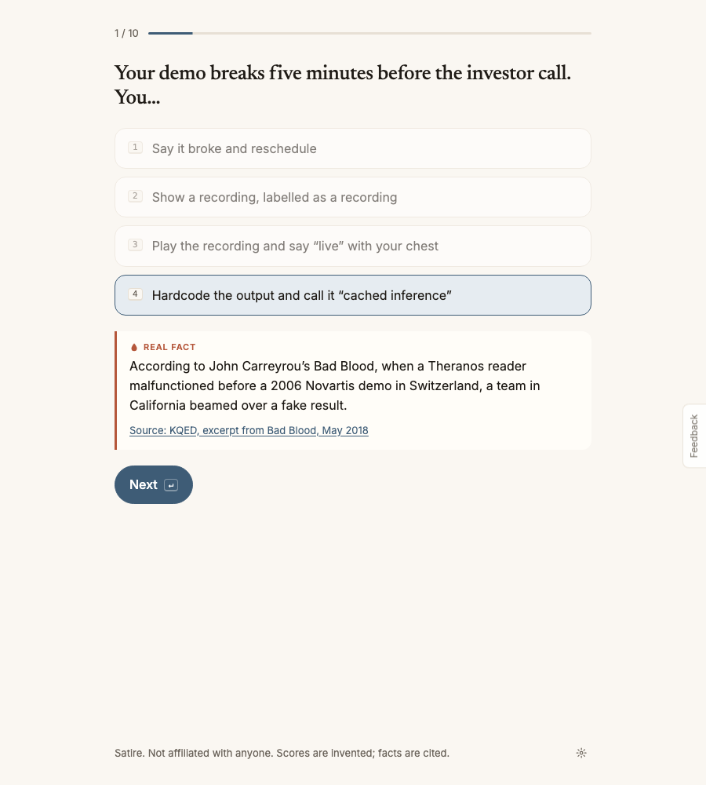
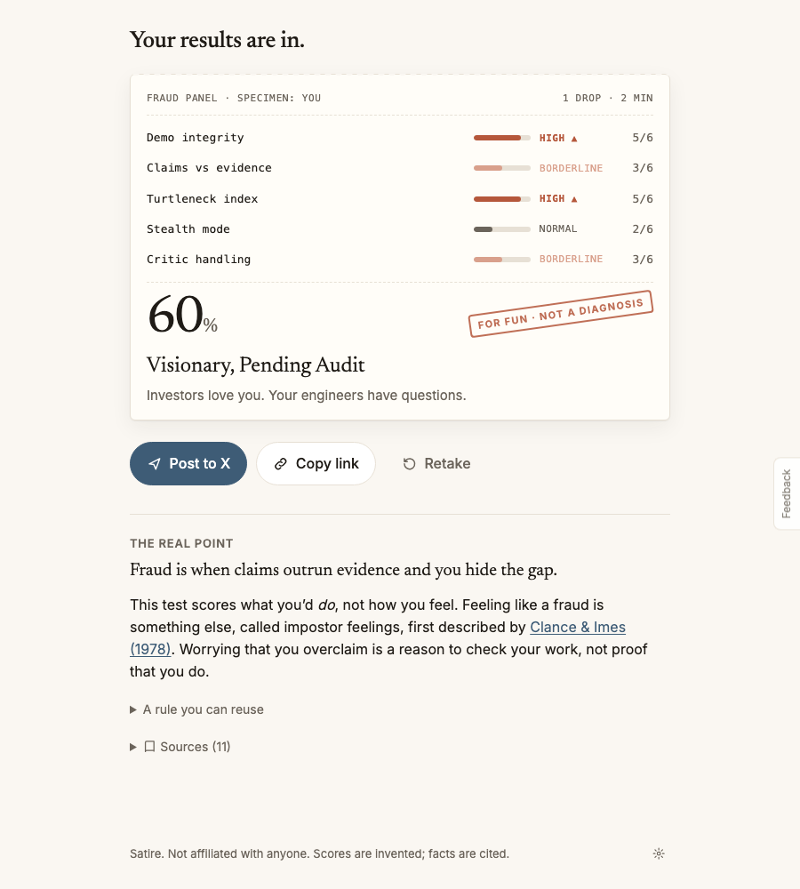
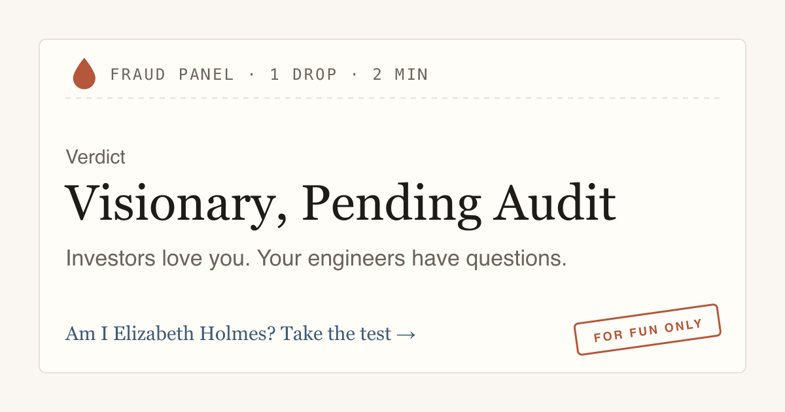

# Am I Elizabeth Holmes?

A 10-question satirical fraud test for founders, researchers and anyone with a pitch deck. Every joke is built on a real, cited Theranos fact. Two minutes, then a result made for posting on X.

**[Take the test →](https://amalmehta.github.io/AmIElizabethHolmes/)**

| Pick an answer, learn the real fact | Get your fraud panel |
|---|---|
|  |  |

What people see when you share your verdict on X:

The scores are invented for comedy. The facts are not: each one links to its source.

- [How to run, build and test it](docs/INSTRUCTIONS.md)
- [System design](docs/SYSTEM-DESIGN.md)
- [What's where](docs/FILE-STRUCTURE.md)
- [Prompt log](docs/PROMPTS.md)

Satire. Not affiliated with Elizabeth Holmes, Theranos or anyone named in the sources.
