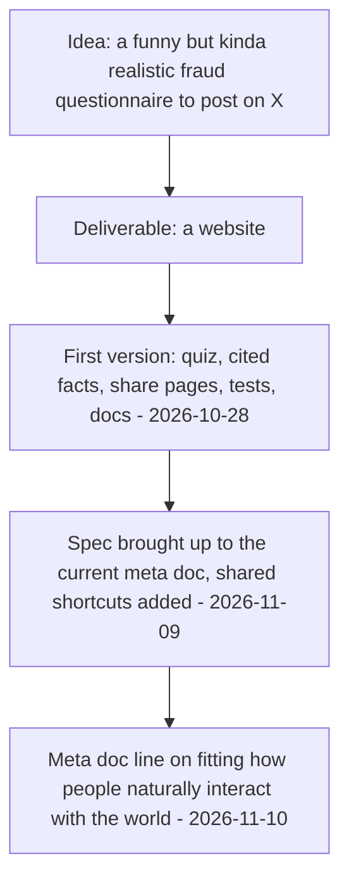
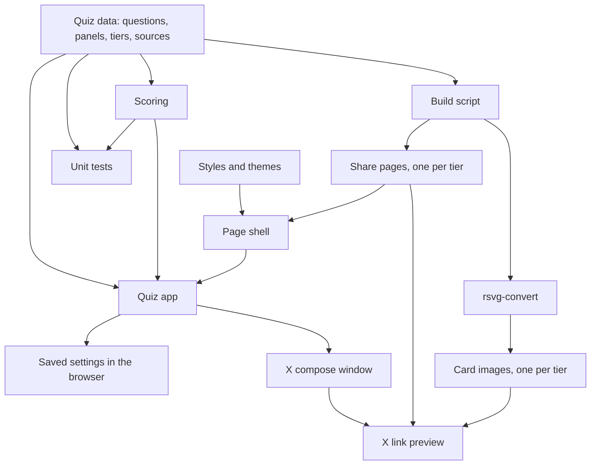
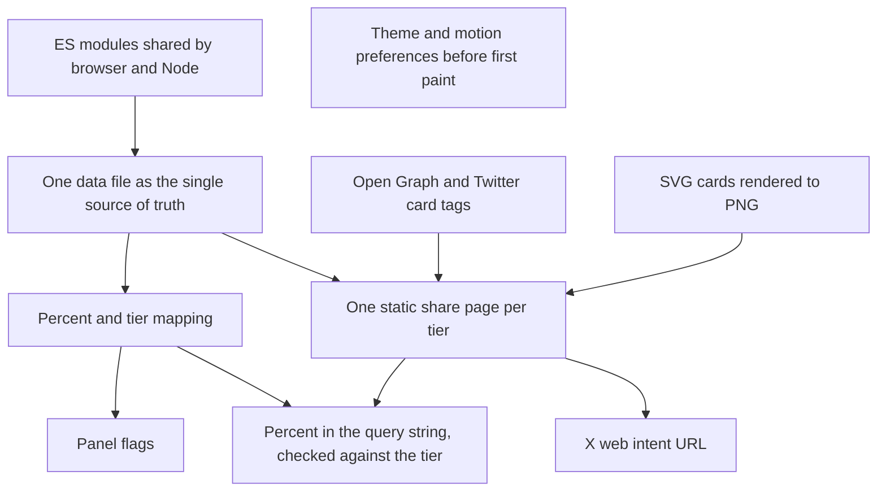

<!-- ProjectForge explainer at cfe6a50 -->
# How AmIElizabethHolmes? was built

Am I Elizabeth Holmes? is a ten-question satirical quiz website. It scores how far your claims outrun your evidence, and it is built to be posted on X. The one idea that makes it work: every answer's score is invented for comedy, but every question is tied to a real, cited fact about Theranos. That makes the joke land, and makes the result worth sharing.

## Build history

No decisions were recorded from the sessions. The history has only three commits, so each commit is its own milestone.

- **First version (2026-10-28):** the whole site arrived in one commit: the quiz, the cited facts, the per-tier share pages, the tests and the docs.
- **Spec update (2026-11-09):** the spec was brought up to the current meta doc, and the shared shortcuts file was added.
- **Meta doc line (2026-11-10):** the spec gained the meta doc's line about fitting how people naturally interact with the world.

## Code map

| Part | File | What it does |
|---|---|---|
| Quiz data | `js/data.js` | Holds the site URL, 5 panels, 10 questions with 4 answers each, each question's fact and source, 5 tiers and the final outcome fact. |
| Scoring | `js/score.js` | Pure functions that turn 10 answer indexes into a total, a percent, a tier and five panel flags. |
| Quiz app | `js/app.js` | Switches screens, renders questions and the result slip, handles keys, settings and the share link. |
| Page shell | `index.html` | The three screens (intro, quiz, result), the settings dialog, and a small script that applies saved theme and motion before first paint. |
| Styles and themes | `css/style.css` | Layout and look, with dark mode and reduced motion driven by system settings or `data-theme` / `data-motion` overrides. |
| Saved settings | `js/app.js` (`store`, `applyPref`) | Reads and writes `aieh-theme` and `aieh-motion` in `localStorage`, wrapped in try/catch. |
| Unit tests | `tests/score.test.mjs` | Checks data integrity, tier coverage of 0–100, boundaries, rounding, panel flags and rejection of bad input. |
| Build script | `scripts/build.mjs` | Generates the share pages, the card PNGs and the icons from `js/data.js`. |
| rsvg-convert | external tool, called in `scripts/build.mjs` | Turns the SVG card and icon into PNG files. |
| Share pages | `r/<tier>/index.html` | Static pages with Open Graph and Twitter tags that X reads to build the link preview. |
| Card images | `og/<tier>.png`, `og/home.png` | The 1200×630 images X shows in the preview. |
| Commands | `package.json` | `npm test` runs the tests, `npm run build` runs the build, `npm run serve` serves the site locally on port 8643. |

## Concepts

**ES modules shared by browser and Node** — An ES module is a JavaScript file that uses `import` and `export`. Both browsers and Node can load the same module file, so one file can run in both. This project needs that so the browser quiz, the Node build and the Node tests all read the exact same data and scoring code. `package.json` sets `"type": "module"`, `index.html` loads `js/app.js` with `type="module"`, and `scripts/build.mjs` and `tests/score.test.mjs` import `js/data.js` and `js/score.js` directly.

**One data file as the single source of truth** — Every question, answer, panel, tier, tier line and source lives in one file. Nothing else hard-codes them. This matters because the share pages and card images are generated files. If they were written by hand, a tier rename in the quiz could leave a stale card on X. Here the build reads `TIERS` and regenerates everything. Lives in `js/data.js`, used by `js/app.js`, `js/score.js` and `scripts/build.mjs`.

**Percent and tier mapping** — Each answer index (0 to 3) is also its score. The total $T$ is the sum of the ten answers, so it ranges from 0 to 30, and the percent is

$$p = \mathrm{round}\left(\frac{100\,T}{30}\right)$$

Since $100T/30 = 10T/3$, the fractional part is always 0, ⅓ or ⅔, never exactly .5, so rounding never hits a tie. The percent then picks the one tier whose inclusive range `min..max` contains it. The ranges are 0–15, 16–35, 36–55, 56–80 and 81–100. `tierFor` throws if no tier matches, and a test checks every integer from 0 to 100 matches exactly one tier. Lives in `js/score.js` (`total`, `percent`, `tierFor`), `js/data.js` (`TIERS`) and `tests/score.test.mjs`.

**Panel flags** — A panel is one of five themes, such as "Demo integrity" or "Stealth mode". Each has exactly two questions, so its score runs from 0 to 6. `flag` maps 0–2 to normal, 3–4 to borderline and 5–6 to high. These rows make the result look like a lab printout, which is the visual joke (the blood test). Lives in `js/score.js` (`flag`, `panels`) and is drawn by `slipHTML` in `js/app.js`. The two-questions-per-panel rule is checked in `tests/score.test.mjs`.

**Open Graph and Twitter card tags** — These are `<meta>` tags in a page's `<head>`, such as `og:title`, `og:image` and `twitter:card`. When a link is posted on X, X fetches the page and reads these tags to build the preview. X does not run the page's JavaScript to do this. So the tags must already be in the HTML file. Lives in `scripts/build.mjs` (`page`), the generated `r/<tier>/index.html` files, and the home tags in `index.html`.

**One static share page per tier** — GitHub Pages (where `SITE_URL` points) serves only fixed files and cannot make a new image per request. So the build makes five pages and five images, one per tier, instead of 101 (one per percent). The cost is that the card shows the tier, not the exact percent. The exact percent goes in the post text instead. Lives in `scripts/build.mjs`, which loops over `TIERS` and writes `r/<id>/index.html` and `og/<id>.png`.

**SVG cards rendered to PNG** — SVG is a text format for vector images. The build writes each card as an SVG string with the tier name and line, then pipes it to `rsvg-convert` to get a 1200×630 PNG, the size X shows for a large-image card. Titles longer than 20 characters drop from font size 92 to 76 so they fit. Text is escaped with `esc` before going into the SVG and HTML. Lives in `scripts/build.mjs` (`card`, `png`, `esc`). The build needs `rsvg-convert` installed (the file's header comment says `brew install librsvg`).

**X web intent URL** — A web intent is a link to `https://x.com/intent/tweet` that opens X's compose box with text already filled in. The `text` and `url` query parameters are encoded with `encodeURIComponent`. This is how "Post to X" works without any login or API key. Lives in `renderResult` in `js/app.js`.

**Percent in the query string, checked against the tier** — The share link is `r/<tier>/?p=<percent>`. The share page's inline script reads `p` and shows "Someone you know scored p% Elizabeth Holmes", but only if `p` is an integer inside that tier's range. Otherwise it keeps the generic line. So a hand-edited link like `r/honest/?p=99` can't show a number that contradicts the page. The range is baked into each page by `page` in `scripts/build.mjs`. You can see it at `r/holmes/index.html:45` (`p >= 81 && p <= 100`).

**Theme and motion preferences before first paint** — A small inline script in the `<head>` reads `aieh-theme` and `aieh-motion` from `localStorage` and sets `data-theme` / `data-motion` on `<html>` before the stylesheet paints. This avoids a flash of the wrong theme. "Auto" removes the attribute, so the CSS falls back to `prefers-color-scheme` and `prefers-reduced-motion`. Lives in `index.html:24`, `applyPref` and `store` in `js/app.js`, and `css/style.css` (lines 13–23 and 184–185).

## One input, start to finish

The input: a visitor picks answers `3, 2, 1, 2, 3, 2, 0, 2, 1, 2` (also the sample slip on the intro screen, `js/app.js:144`).

1. **Page loads.** `index.html` runs the inline preference script, then loads `js/app.js` as a module. At load, `app.js` fills `#sample-slip` with `slipHTML(result([...]))` and fills the sources list from `QUESTIONS` plus `OUTCOME` (11 sources).
2. **Start.** The visitor clicks "Start the test" or presses Enter. The `keydown` handler or `$('start').onclick` calls `start` in `js/app.js`. It resets `state.i` to 0 and `state.answers` to ten `null`s, calls `show('quiz')`, then `renderQuestion`.
3. **Show question 1.** `renderQuestion` reads `QUESTIONS[0]` from `js/data.js`, writes the question and four answer buttons, and puts the fact and source link in place. The fact stays hidden until `#quiz` gets the `answered` class.
4. **Answer.** The visitor presses `4`. The `keydown` handler maps it to `choose(3)`. `choose` stores `3` in `state.answers[0]`, sets `aria-pressed` on the buttons, adds `answered` (which reveals the cited fact) and advances the progress bar.
5. **Next.** Enter calls `next`. It refuses to move on while the answer is `null`, otherwise it increments `state.i` and calls `renderQuestion`. Steps 3–5 repeat for all ten questions.
6. **Score.** On the last question, `next` calls `renderResult`, which calls `result(state.answers)` in `js/score.js`.
   - `total` checks there are 10 integers in 0–3 and sums them: 3+2+1+2+3+2+0+2+1+2 = 18.
   - `percent` returns round(100 × 18 / 30) = 60.
   - `tierFor(60)` returns the `audit` tier, "Visionary, Pending Audit" (56–80).
   - `panels` sums each panel's two answers and calls `flag`: Demo integrity 5 (high), Claims vs evidence 3 (borderline), Turtleneck index 5 (high), Stealth mode 2 (normal), Critic handling 3 (borderline).
7. **Draw the slip.** `slipHTML` in `js/app.js` builds the five rows with meter widths of `100 × score / 6` percent (at least 4%), then "60%", the tier name and the line "Investors love you. Your engineers have questions."
8. **Build the share link.** `shareURL` returns `https://amalmehta.github.io/AmIElizabethHolmes/r/audit/?p=60`. `renderResult` sets "Post to X" to an `x.com/intent/tweet` link whose text is "I’m 60% Elizabeth Holmes. “Investors love you. Your engineers have questions.”" followed by that URL. "Copy link" calls `copy`, which uses the clipboard API, or falls back to `prompt` if that fails.
9. **X builds the preview.** X fetches `r/audit/index.html`, generated earlier by `page` in `scripts/build.mjs`. It reads the `og:` and `twitter:` tags and shows `og/audit.png`, the card that `card` and `png` rendered.
10. **A friend clicks through.** The share page's inline script reads `p=60`, checks it is an integer from 56 to 80, and changes the line to "Someone you know scored 60% Elizabeth Holmes." Its "Take the test yourself" button links back to `index.html`.

## Where this came from

Written from the spec, the decisions (none recorded), the git history and the code as of commit `cfe6a50`.
