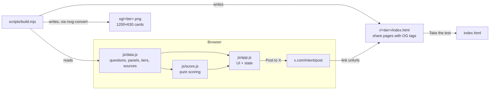

# System design

A static, ten-question satirical quiz. It runs entirely in the browser, stores nothing and is hosted free on GitHub Pages. Its one job: give people a funny, cited verdict they want to post on X.

## Architecture

| Piece | Job |
|---|---|
| `js/data.js` | The single source of truth: 10 questions (4 answers each, scored 0–3), 5 panels (2 questions each), 5 verdict tiers and a cited fact per question. |
| `js/score.js` | Pure functions: answers → total, percent, panel flags, tier. No DOM, so it can be unit-tested in Node. |
| `js/app.js` | Screens (intro → question → fact reveal → result), keyboard shortcuts, settings, share link. |
| `scripts/build.mjs` | Generates one share page and one PNG card per tier from `data.js`, so the cards never drift from the quiz. |
| `r/<tier>/` | What X unfurls. Static `og:` and `twitter:` tags point to that tier's card. The page shows the sharer's exact percent (from `?p=`) and a "Take the test" button. |

## Main flows

1. **Take it.** Intro → Q1…Q10. Choosing an answer reveals the real fact behind the question, with its source, in place. Next (or Enter) moves on. The work per step is a class swap, so the response is instant.
2. **Result.** A "fraud panel" lab printout: five rows (normal / borderline / high), the percent and the tier. Then a one-line real point and a link to sources.
3. **Share.** "Post to X" opens the X compose intent with the text `I'm 68% Elizabeth Holmes…` and the link `r/<tier>/?p=68`. X fetches that page's static OG tags and shows the tier card.

## Scoring (defined, not measured)

- Each answer scores 0–3. Total *T* ranges from 0 to 30. Percent *p* = round(100 · *T* / 30).
- Panel score = the sum of its two questions (0–6): **normal** at 0–2, **borderline** at 3–4, **high** at 5–6.
- Tiers by *p*: 0–15 Clinically Honest · 16–35 Rounds Up · 36–55 Pre-Revenue Visionary · 56–80 Visionary, Pending Audit · 81–100 Elizabeth Holmes.
- These weights are invented for comedy, and the UI says so. The percent is not a measurement of anything.

## Where data lives

Nowhere. There is no backend, no analytics and no cookies. Answers live in memory while the page is open, and two preferences (theme, reduced motion) are kept in `localStorage`, wrapped in try/catch so the page still works when storage is blocked.

## Key decisions and trade-offs

| Decision | Why | Cost |
|---|---|---|
| Vanilla HTML/CSS/JS, no build step for the site | Fewest moving parts. Instant load on a phone, from a link, from X's in-app browser. | No components. Fine at this size (~3 screens). |
| One static share page per tier (5) rather than per score | GitHub Pages can't render images on request, and X reads OG tags without running JS. | The card shows the tier, not the exact percent. The exact percent is in the post text instead. |
| No "you vs everyone" stats | Any such number would be made up without a backend. | Less social proof. Revisit with a counter if people ask (see below). |
| Facts cited per question | The spec says nothing made up passes as fact, and the joke is funnier when it's true. | Wording must stay attributable ("according to…"). |
| Fonts from Google Fonts (Newsreader, Inter) with system fallbacks | Matches the house style. | One third-party request. The page renders with fallbacks if it's blocked. |

## Testing

- `node --test tests/` covers the scoring edge cases (all 0s, all 3s, tier boundaries 15/16, 35/36, 55/56, 80/81, panel thresholds, incomplete answers rejected) and data integrity (10 questions, 4 answers each, scores 0–3 used once each, every fact has a source URL, every tier has a card).
- End to end: the site is driven in a browser through all three paths (lowest, highest, mixed). Settings, keyboard and share URL were checked, as were dark mode and a 375 px phone width.

## Scale and what would change

Today's load is a viral spike at worst. Static files on a CDN handle that for free, and there's nothing to scale.
- **Real "percent of takers" stats:** needs a write endpoint (e.g. a Supabase table or a Cloudflare Worker + KV) plus rate limiting. That only makes sense if a few thousand people take it.
- **Exact-percent cards:** needs on-demand image rendering (Vercel OG or a Cloudflare Worker). Only worth it if the tier card looks weak in real posts.
- **Translations:** `data.js` would gain a locale key, and the build would emit cards per locale.

## Known limits

- Satire about a real, convicted public figure. Every factual claim is attributed and sourced, there is no likeness or photo, and nothing imitates Theranos branding.
- X caches cards. After you change a card, it can take time, or a re-validation, to update.
- The percent is a joke metric. It can be "gamed" trivially by picking the honest answers, which is fine, because it isn't measuring anything.
